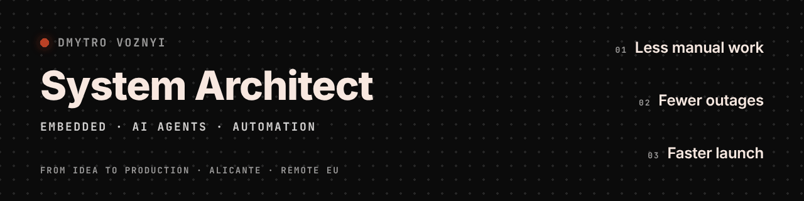

### System Architect · Embedded & AI Automation

I build dedicated systems that run themselves: embedded devices that decide on-site, AI where it actually saves time, and automation where people shouldn't have to step in. From the device to production.

**Less manual work · Fewer outages · Faster launch**

---

### What I've built

| | System | What it does |
| --- | --- | --- |
| 01 | **Autonomous greenhouse** | An embedded controller reads sensors, drives relays and makes decisions on-site. Keeps working with no cloud and no connection. |
| 02 | **Lab equipment monitoring** | Embedded monitoring and control for university lab equipment. Spots problems before they stop the work. |
| 03 | **AI pipelines in production** | Took repetitive manual data work off the team and made the result checkable. |
| 04 | **Client brand sites** | From a design to a live site on its own server, with every change shipped automatically. [drylabfood.es](https://drylabfood.es) · [Maximus Group](https://maximusgroup.nexo-soft.com) |
| 05 | **AI-run delivery process** | My own project management run by AI coding agents: tasks, execution, review and reports across all projects. |

Most of this code is private or under NDA. Ask me about the architecture.

---

### How I work with AI agents

Start from the outcome, decide what must work with no human and no connection, make every part measurable, and keep the system simpler to run as it grows. Agents do the routine; I own the architecture, the review and the decision. AI is a component, not the product.

---

[LinkedIn](https://www.linkedin.com/in/dmytro-voznyi) · [Instagram](https://www.instagram.com/dmytro.es) · Alicante, Spain · open to remote/hybrid EU
